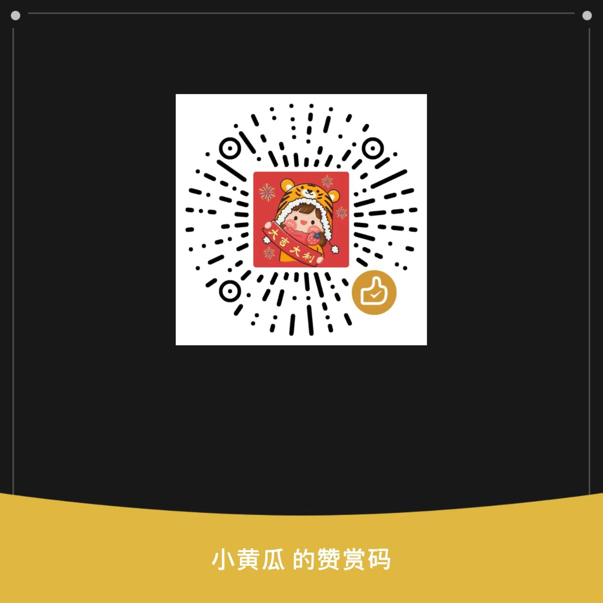

# 拾讯 · Shixun

**学校通知太分散？把重要消息整理成待办，让该记住的事有个着落。**

[下载最新版 APK](https://github.com/a33633/shixun-android/releases/latest) · [查看每版更新](https://github.com/a33633/shixun-android/releases) · [反馈问题与建议](https://github.com/a33633/shixun-android/issues)

## 为什么做这个软件

主包是个大学生。作业在微信群，班级通知在 QQ，课程安排又在学习通……软件一堆，消息也一堆。想找一条有用的信息，简直是在大海捞针。

我在 GitHub 上找过一些工具，但没找到完全符合自己需求的，于是尝试用 AI 做了一个：**拾讯**。希望它能帮我，也帮有同样困扰的同学，把分散的学习消息整理到一起。

## 它能做什么

- **清晰的待办界面**：首页概览、时间范围与通知来源分层展示；任务详情使用紧凑工具分组，设置分为常用设置和工具与支持，后台刷新减少列表跳动。
- **待办来源标签**：每条待办显示微信、QQ、学习通等软件标签，群名或联系人另行保留；手动创建、文字导入和图片识别分别标注，已完成、详情及小组件等视图同步显示。
- **选择关注的应用**：从微信、QQ、钉钉、学习通等应用提供的系统通知中接收消息，来源应用由你选择。
- **群与联系人筛选**：从已选软件的系统通知收集名称，在 **设置 → 通知接收与后台 → 群与联系人** 按软件搜索、批量移出匹配或恢复。忽略后不再自动识别其新通知，保留本地记录与已有待办；不同软件的同名群互不影响。
- **提取重要事项**：整理作业、考试、报名、材料提交和班级通知；有明确时间的安排提醒，没有时间的保留在待办中。
- **显示起止时间**：支持开始和结束时间范围，可手动修改，也能带入系统日历确认保存。只有开始时间的任务也进入“接下来”；同一分组内优先按截止时间排序，没有截止时间则按开始时间。
- **结合上下文整理**：联网模式下参考同一会话 24 小时内的有限上下文；明确的补充消息可合并，改期、取消和时间冲突留待确认。
- **集中管理待办**：支持编辑、完成、删除、置顶、子任务、重复提醒及文件附件。首页可直接查看已完成任务和通知识别记录。回收站保留最近 7 天删除的任务，到期自动清理。
- **备用模型重新识别**：点开待办，在详情右上角点击“重新识别”，使用备用模型重新分析原始文字；核对结果后更新当前待办，保留附件和子任务。
- **文字和图片导入**：在“新建待办”中导入文字或图片，识别后预览、修改，再确认创建或取消。
- **悬浮球快捷入口**：支持快捷新建、文字导入、截图导入；支持跨应用拖拽的应用还可把文字或单张图片拖入识别。
- **学习与桌面工具**：学习计划、课程标签、优先级、任务日历、每日总览，以及可调整大小的桌面小组件。小组件最小尺寸仍显示待办和时间，上下滑动可查看全部未完成任务；无时间的任务不显示占位文字。

## 可以选择怎样识别

| 方式 | 说明 |
| --- | --- |
| 普通模型直接分析 | 使用自己配置的大模型服务筛选消息、提取任务。 |
| Jev 判断 + 普通模型 | 先由 Jev 判断重要性，再由普通模型提取；支持 AIHubMix 的 Jev 接入配置。 |
| 离线基础识别 | 使用本机关键词和日期规则，不需要网络或模型密钥；准确率通常低于在线大模型，复杂语境容易漏识别，不支持图片识别。 |

联网功能需要你自行配置服务地址、模型名称和 API Key，模型服务商可能收取调用费用。图片识别需使用支持图片输入的模型，可在 **设置 → 识别与模型 → 图片识别模型** 中沿用普通模型服务商，也可独立填写其他服务商的 HTTPS 接口、模型名称和 API Key。目前支持兼容 Chat Completions 的图片接口。

## 安装与开始使用

1. 前往 [Releases](https://github.com/a33633/shixun-android/releases/latest)，下载 **Assets** 中的 `.apk` 文件并安装。支持 Android 8.0 及以上；更新时使用同签名版本覆盖安装。
2. 新用户第一次打开会进入使用引导：先选择**在线识别**或**离线识别**。在线模式填写模型接口地址、模型名称和 API Key；离线模式不用填密钥，但准确率较低。
3. 选择来源应用并保存，开启**通知使用权**和**无障碍通知接收**。这两项为必开权限；**Shizuku 是可选增强**，不开启也能完成引导并开启自动整理。
4. 按引导允许提醒通知、准时提醒和后台运行，最后核对实际状态并确认开启自动整理。权限未齐可先进入待办页，自动整理保持关闭。
5. 老用户覆盖安装不强制弹出引导，可以从 **设置 → 使用引导** 重新配置。模型测试、10 秒测试提醒、接收自检及无障碍启动诊断，统一在 **设置 → 开发者选项**。

想使用悬浮球，可在 **设置 → 悬浮球** 允许显示在其他应用上层，返回后开启。截取当前屏幕会单独请求系统授权。

## 使用前了解这些

- 拾讯接收的是系统提供的通知内容。它不会读取完整聊天记录；免打扰、隐藏通知详情或系统后台限制可能影响接收。
- 通知、待办和附件副本保存在本机；模型密钥在本机加密保存。联网识别会把相关内容发送给你配置的模型服务。
- 普通图片导入需确认发送；开启悬浮球时授权的主动拖入内容可自动解析，结果仍需确认后才创建待办。
- AI 可能误判，重要事项和时间请结合原通知核对。不同品牌手机的后台、悬浮窗及拖拽行为可能不同；不支持拖拽时可用系统分享或图片选择器导入。
- 悬浮球拖拽、系统截屏以及部分 vivo 机型的无障碍稳定性仍需真机反馈。请查看对应版本的更新说明了解验证范围。

目前这个仓库用于发布安装包、更新说明和项目介绍。欢迎在 [Issues](https://github.com/a33633/shixun-android/issues) 反馈问题：附上软件版本、手机型号、系统版本和复现步骤，会更方便排查。请不要公开 API Key 或含私人聊天内容的截图。

## 感谢与赞赏

拾讯是我一边学习、一边借助 AI 完善的小项目。感谢每一位愿意下载试用、反馈问题、提出建议和分享给同学的朋友。

如果它帮你少漏了一条通知、少错过一次截止时间，也欢迎通过下面的微信赞赏码支持一下。**赞赏完全自愿，不影响软件使用。**

  

谢谢你的支持，也希望拾讯能让你的学习生活少一点手忙脚乱。
